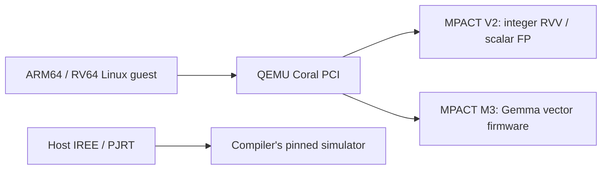
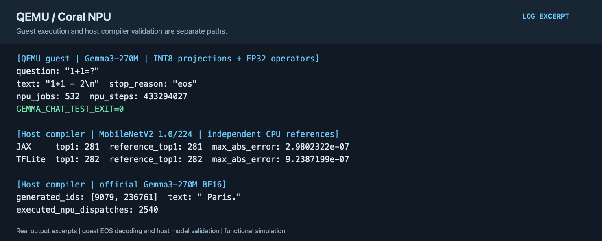

# QEMU Coral NPU instruction-level functional simulation

English | [简体中文](README.zh-CN.md)

QEMU supplies the PCI device and guest memory; Coral MPACT executes NPU instructions. The basic V2 and Gemma M3 backends have separate ABIs. Coral compiler validation through IREE/PJRT is a separate host-side path.

## Implementation

- The QEMU PCI device handles registers, memory windows, job submission, status, and reset. A C ABI passes NPU firmware to host MPACT for execution.
- The guest CPU runs ARM64 or RV64 while NPU firmware uses a separate RV32/RVV instruction stream. The Gemma path shares weight and KV memory; the guest handles tokenization, scheduling, and result processing.
- The host compiler converts models into IREE/PJRT dispatches and executes them with its pinned simulator dependency. Host and QEMU guest paths have separate acceptance checks.



QEMU, coralnpu-mpact, coralnpu, and coralnpu-compiler use `coral-npu-isa`. QEMU is based on v11.1.3; exact revisions are in [project.json](project.json). Source repositories remain independent and this project assembles them. The compiler retains its upstream MPACT revision instead of using the QEMU bridge backend.

## Build and validate Linux guests

Read the [shared environment, kernel, and toolchain guide](../../common/accelerators/README.md). These commands use RV64; choose `--arch arm64` for ARM64:

```sh
python3 tools/accelerator.py qemu-coral-isa doctor
projects/qemu-coral-isa/fetch.sh
projects/qemu-coral-isa/build.sh --component qemu
projects/qemu-coral-isa/build.sh --component backend
projects/qemu-coral-isa/build.sh --component guest --arch riscv64
projects/qemu-coral-isa/test.sh --suite backend
projects/qemu-coral-isa/prepare.sh --images /path/to/images --arch riscv64
projects/qemu-coral-isa/test.sh --arch riscv64 --timeout 120
```

Backend tests execute add/RVV workloads, LMUL 1/2/4/8 floating-point broadcasts, and error paths. Guest checks cover four floating-point additions, 15 quantized RVV cases, interrupt status, timeout, BUSY isolation, reset, and recovery. Both `CORAL_GUEST_ALL_PASS` and `CORAL_TEST_EXIT=0` are required.

The additional `digits` suite compiles two supported fully connected operators from an actual INT8 TFLite FlatBuffer and checks every output score for 20 inputs. This restricted compiler is separate from MobileNetV2 and the official Coral compiler:

```sh
export TFLITE_PYTHON=/path/to/litert-venv/bin/python
projects/qemu-coral-isa/build.sh --component guest --suite digits --arch riscv64
projects/qemu-coral-isa/prepare.sh --suite digits --images /path/to/images
projects/qemu-coral-isa/test.sh --suite digits
```

## MobileNetV2 and Gemma3-270M

`build.sh --component compiler` builds Coral IREE/PJRT tools with their pinned submodules and repository-provided IREE patches. Set `MODEL_PYTHON` to a Python environment with the compiler's model dependencies. Key versions are gemma 4.0.1, jax/jaxlib 0.11.1, keras 3.14.1, numpy 2.4.6, Pillow 12.2.0, and tosa-converter-for-tflite 2026.2.0; ai-edge-litert is also required.

```sh
projects/qemu-coral-isa/build.sh --component compiler
MODEL_PYTHON=/path/to/model-python projects/qemu-coral-isa/test.sh --suite mobilenet --timeout 21600
python3 common/accelerators/download_gemma_jax.py \
  --objects projects/qemu-coral-isa/models/gemma-jax-objects.json \
  --out "$LAB_WORK/models/gemma3-jax-official"
export CORAL_GEMMA_CHECKPOINT="$LAB_WORK/models/gemma3-jax-official"
export CORAL_GEMMA_TOKENIZER=/path/to/tokenizer_gemma3.model
MODEL_PYTHON=/path/to/model-python projects/qemu-coral-isa/test.sh --suite gemma --timeout 21600
```

MobileNetV2 uses the official 1.0/224 model, with separate JAX and TFLite import paths. Each compares output scores against its CPU reference and requires actual NPU dispatches. Gemma uses the official JAX BF16 checkpoint and checks reference tokens and execution counters for a fixed prompt. These are **host IREE/PJRT validations**.

QEMU guest Gemma uses separate firmware with INT8 projections and FP32 operators elsewhere. Prepare SentencePiece v0.2.1 source (`SENTENCEPIECE_SOURCE`) and complete model assets (`GEMMA_ARTIFACTS`) as described in the [Gemma asset guide](gemma.md), then run:

```sh
projects/qemu-coral-isa/build.sh --component guest --suite gemma-guest
CORAL_GEMMA_PROMPT='1+1=?' \
  projects/qemu-coral-isa/prepare.sh --suite gemma-guest --images /path/to/images
projects/qemu-coral-isa/test.sh --suite gemma-guest --timeout 21600
```

Acceptance requires a complete EOS response, job counts covering all 18 layers and 64 vocabulary chunks, tokenization, and memory execution evidence. Timeout or truncation fails validation. Functional counters are not RTL performance measurements.

## Example output



The figure distinguishes complete EOS generation inside the QEMU guest from host MobileNet and BF16 Gemma validation. It is typeset from actual acceptance output, rather than a desktop capture. See the [text excerpt](images/test-output.txt).
