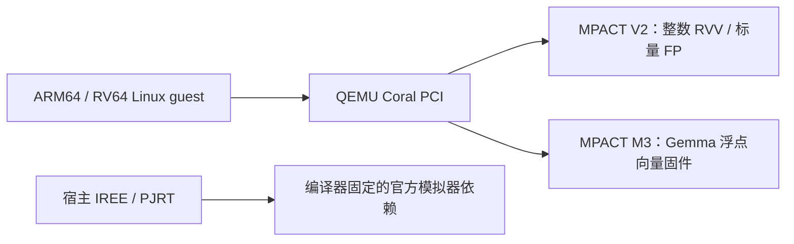
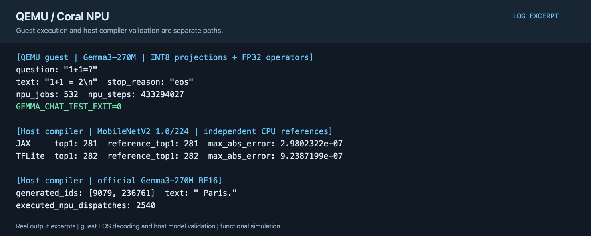

# QEMU Coral NPU 指令级功能模拟

[English](README.md) | 简体中文

QEMU 提供 PCI 设备与客体内存，Coral MPACT 执行 NPU 指令。基本 V2 和 Gemma M3 两种后端具有独立 ABI。Coral compiler 的 IREE/PJRT 验证是另外一条宿主编译器链路。

## 实现内容

- QEMU 的 PCI 设备负责寄存器、内存窗口、作业提交、状态和复位；通过 C ABI 把 NPU 固件交给宿主 MPACT 执行。
- guest CPU 使用 ARM64 或 RV64，NPU 固件使用独立的 RV32/RVV 指令流。Gemma 路线共享权重与 KV 内存，guest 负责分词、调度和结果处理。
- Coral compiler 路线在宿主上把模型转换为 IREE/PJRT dispatch，再交给其固定模拟器依赖执行；与 QEMU guest 路线分别验收。



源码分支统一为 `coral-npu-isa`：QEMU、coralnpu-mpact、coralnpu、coralnpu-compiler。QEMU 基于 v11.1.3；具体提交见 [project.json](project.json)。四个仓库分别维护源码，这里组装工程。编译器内部的 MPACT 依赖保留上游版本，不替换成 QEMU 桥接后端。

## 构建和 Linux guest 验证

先阅读[共用环境、内核与交叉工具链说明](../../common/accelerators/README.zh-CN.md)。以下命令以 RV64 为例，ARM64 将 `--arch` 改为 `arm64`：

```sh
python3 tools/accelerator.py qemu-coral-isa doctor
projects/qemu-coral-isa/fetch.sh
projects/qemu-coral-isa/build.sh --component qemu
projects/qemu-coral-isa/build.sh --component backend
projects/qemu-coral-isa/build.sh --component guest --arch riscv64
projects/qemu-coral-isa/test.sh --suite backend
projects/qemu-coral-isa/prepare.sh --images /path/to/images --arch riscv64
projects/qemu-coral-isa/test.sh --arch riscv64 --timeout 120
```

后端检查实际 add/RVV 模型、LMUL 1/2/4/8 浮点广播和错误路径。Linux guest 检查 4 组浮点加法、15 组量化 RVV 模型、中断状态、超时、BUSY 隔离、复位与恢复。`CORAL_GUEST_ALL_PASS` 和 `CORAL_TEST_EXIT=0` 须同时出现。

额外的 `digits` suite 从真实 INT8 TFLite FlatBuffer 编译受限的两个全连接算子，验证 20 组输入的全部输出分数；它不是 MobileNetV2，也不是官方 Coral compiler：

```sh
export TFLITE_PYTHON=/path/to/litert-venv/bin/python
projects/qemu-coral-isa/build.sh --component guest --suite digits --arch riscv64
projects/qemu-coral-isa/prepare.sh --suite digits --images /path/to/images
projects/qemu-coral-isa/test.sh --suite digits
```

## MobileNetV2 与 Gemma3-270M

`build.sh --component compiler` 单独构建 Coral IREE/PJRT 工具。compiler 获取后使用其固定子模块及仓库自带 IREE 补丁。模型 Python 环境使用 `MODEL_PYTHON`，需安装 compiler 的 Python 依赖；主要依赖版本为 gemma 4.0.1、jax/jaxlib 0.11.1、keras 3.14.1、numpy 2.4.6、Pillow 12.2.0、tosa-converter-for-tflite 2026.2.0，另需 ai-edge-litert。

```sh
projects/qemu-coral-isa/build.sh --component compiler
MODEL_PYTHON=/path/to/model-python projects/qemu-coral-isa/test.sh --suite mobilenet --timeout 21600
python3 common/accelerators/download_gemma_jax.py \
  --objects projects/qemu-coral-isa/models/gemma-jax-objects.json \
  --out "$LAB_WORK/models/gemma3-jax-official"
export CORAL_GEMMA_CHECKPOINT="$LAB_WORK/models/gemma3-jax-official"
export CORAL_GEMMA_TOKENIZER=/path/to/tokenizer_gemma3.model
MODEL_PYTHON=/path/to/model-python projects/qemu-coral-isa/test.sh --suite gemma --timeout 21600
```

MobileNetV2 使用官方 1.0/224 模型，JAX/TFLite 两条导入路径逐分数比较 CPU 参考，并要求真实 NPU dispatch。Gemma 使用官方 JAX BF16 检查点，校验固定提示词的 token 和 NPU 执行计数。此处均为**宿主 IREE/PJRT 验证**。

QEMU guest 的 Gemma 使用 INT8 投影、FP32 其余算子的独立固件路径。需准备 SentencePiece v0.2.1 源码（`SENTENCEPIECE_SOURCE`）与完整权重资产（`GEMMA_ARTIFACTS`）；参考 [Gemma 资产与执行说明](gemma.zh-CN.md)，再执行：

```sh
projects/qemu-coral-isa/build.sh --component guest --suite gemma-guest
CORAL_GEMMA_PROMPT='1+1=?' \
  projects/qemu-coral-isa/prepare.sh --suite gemma-guest --images /path/to/images
projects/qemu-coral-isa/test.sh --suite gemma-guest --timeout 21600
```

该验收要求完整 EOS 回答、全部 18 层与 64 个词表分片的作业计数、分词和内存执行证据；提前超时或截断回答不判定通过。功能模拟的计数不作为 RTL 性能数据。

## 运行示例



图中分别展示 QEMU guest 的完整 Gemma EOS 生成，以及宿主编译器的 MobileNet／BF16 Gemma 验证；两条执行路径单独标注。 图片由实际验收日志的选段排版生成，并非桌面截图；可查看[文本摘录](images/test-output.txt)。
