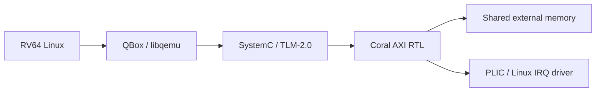
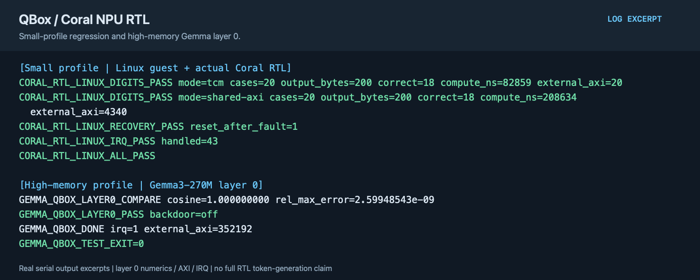

# QEMU / QBox Coral NPU RTL co-simulation

English | [简体中文](README.zh-CN.md)

QBox combines Qualcomm libqemu CPUs, TLM memory, and the Coral Verilator model in one SystemC kernel. NPU computations execute in RTL.

## Implementation

- Verilator generates a model from the pinned Coral source, which is rebuilt against the same SystemC kernel as QBox. TLM connects the CPU, control registers, TCM, and external memory.
- An AXI bridge handles RTL-initiated memory transactions. Completion interrupts reach the Linux IRQ driver through the PLIC; the guest waits for completion and checks results.
- `small` covers addition, classification, and recovery. `gemma` provides larger TCM and external-memory mappings for numerical validation of model layer 0.



QBox and coralnpu each use `coral-npu-rtl` from a pinned upstream base. `small` and `gemma` have separate default build and artifact subdirectories; use separate paths for both profiles when overriding `--build` or `--artifacts`. SystemC/CCI/SCP/libqemu revisions are in [project.json](project.json). No separate SystemC/TLM fork is needed.

```sh
projects/qemu-coral-rtl/fetch.sh
projects/qemu-coral-rtl/build.sh --component rtl --profile small
projects/qemu-coral-rtl/build.sh --component qbox --profile small
TFLITE_PYTHON=/path/to/litert-python \
  projects/qemu-coral-rtl/build.sh --component guest --profile small
projects/qemu-coral-rtl/build.sh --component driver
projects/qemu-coral-rtl/test.sh --suite smoke --profile small
projects/qemu-coral-rtl/prepare.sh --profile small --images /path/to/images
projects/qemu-coral-rtl/test.sh --profile small --timeout 600
```

See the [shared guide](../../common/accelerators/README.md) for environment and kernel-module configuration. `rtl` generates model sources at the locked revision before rebuilding them against platform SystemC. The `small` Linux suite covers addition, 20 TFLite cases through both TCM and shared AXI, illegal instructions, recovery, and 43 handled IRQs.

## Gemma profile

Prepare weights using the [Gemma asset guide](../qemu-coral-isa/gemma.md). Run the `rtl`, `qbox`, `guest`, `driver`, and `prepare` stages with `--profile gemma`, followed by `test.sh --profile gemma --suite gemma --timeout 14400`. The `guest` stage builds high-memory firmware and a Linux runner; `driver` builds an IRQ module matching the kernel. `prepare` reads weights from `GEMMA_ARTIFACTS`.

The default high-memory acceptance checks **layer 0 numerics, external AXI access, and IRQ delivery**. It does not establish full RTL token generation. A full chat interface remains in coralnpu's `integration/rtl/chat/`; long generation runs require their own complete audit.

Longer timeouts do not relax numerical, IRQ, or AXI checks. The QEMU CPU and TLM platform do not form a cycle-accurate whole-system model.

## Example output



The figure shows classification and IRQ checks with the small profile, followed by layer 0 numerical, AXI, and IRQ checks with the high-memory profile. Full RTL text generation is outside this example. It is typeset from actual acceptance output, rather than a desktop capture; see the [text excerpt](images/test-output.txt).
