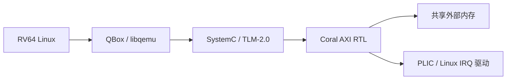
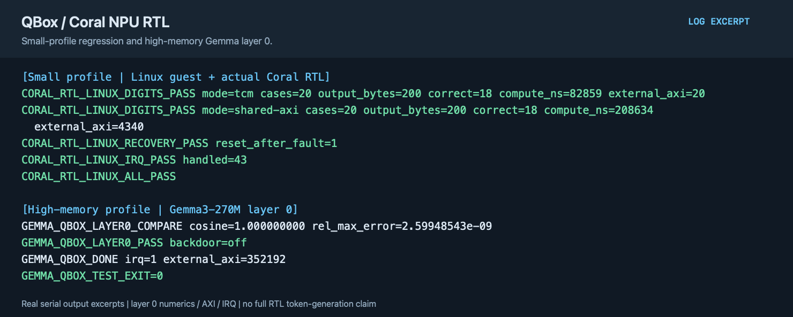

# QEMU／QBox Coral NPU RTL 联合仿真

[English](README.md) | 简体中文

QBox 在同一 SystemC 内核中组合 Qualcomm libqemu CPU、TLM 内存与 Coral Verilator RTL 模型。NPU 运算由实际 RTL 执行。

## 实现内容

- 从锁定的 Coral 源码生成 Verilator 模型，并与 QBox 使用同一 SystemC 内核；TLM 事务连接 CPU、控制寄存器、TCM 和外部内存。
- AXI 桥处理 RTL 发起的外部访存，完成中断经 PLIC 送达 Linux IRQ 驱动，guest 据此等待并检查作业结果。
- `small` 用于加法、分类和恢复测试；`gemma` 使用更大的 TCM／外部内存布局，执行真实模型的 layer 0 数值验证。



QBox 与 coralnpu 使用 `coral-npu-rtl`，各自从固定上游基线创建。`small` 和 `gemma` 使用独立的默认构建与负载子目录；若显式传入 `--build` 或 `--artifacts`，也需为两种配置分别指定目录。SystemC/CCI/SCP/libqemu 版本见 [project.json](project.json)，无需另建 SystemC/TLM 仓库。

## 构建与验证

```sh
projects/qemu-coral-rtl/fetch.sh
projects/qemu-coral-rtl/build.sh --component rtl --profile small
projects/qemu-coral-rtl/build.sh --component qbox --profile small
TFLITE_PYTHON=/path/to/litert-python \
  projects/qemu-coral-rtl/build.sh --component guest --profile small
projects/qemu-coral-rtl/build.sh --component driver
projects/qemu-coral-rtl/test.sh --suite smoke --profile small
projects/qemu-coral-rtl/prepare.sh --profile small --images /path/to/images
projects/qemu-coral-rtl/test.sh --profile small --timeout 600
```

环境和内核驱动配置见[共用说明](../../common/accelerators/README.zh-CN.md)。`rtl` 首先从当前锁定源码生成模型，再以平台 SystemC 重新编译；不复用未核对来源的旧 RTL 产物。`small` Linux 验收包括真实加法、20 组 TFLite 分类分别经 TCM/共享 AXI 执行、非法指令、恢复和 43 次 IRQ。

## Gemma 配置

Gemma 配置使用高内存 RTL。按照 [Gemma 资产说明](../qemu-coral-isa/gemma.zh-CN.md) 准备权重，然后分别执行 `rtl`、`qbox`、`guest`、`driver`、`prepare` 阶段，均传入 `--profile gemma`，最后运行 `test.sh --profile gemma --suite gemma --timeout 14400`。`build --component guest` 编译高内存固件与 Linux runner，`build --component driver` 编译匹配内核的 IRQ 模块；`prepare` 从 `GEMMA_ARTIFACTS` 读取权重。该配置默认验收 **layer 0 数值、外部 AXI 访问和 IRQ**；这不代表完整 Gemma token 生成已通过。完整对话源接口另保留在 coralnpu 的 `integration/rtl/chat/`，长时间 RTL 生成应单独保存完整审计结果。

RTL 测试允许增加超时，但不因耗时长而放宽数值、IRQ 或 AXI 检查。QEMU CPU 与 TLM 平台并不构成整机周期精确模型。

## 运行示例



图中展示小内存 RTL 的分类／IRQ 测试，以及高内存 RTL 的 Gemma layer 0 数值、AXI 和 IRQ 结果；范围不包括完整 RTL 文本生成。 图片由实际验收日志的选段排版生成，并非桌面截图；可查看[文本摘录](images/test-output.txt)。
