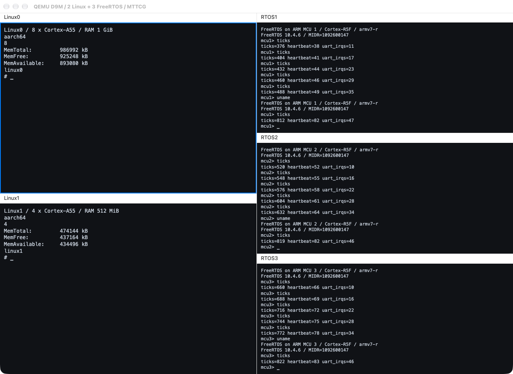

# qemu-d9m: five Cocoa serial consoles

English | [简体中文](README.zh-CN.md)

QEMU branch: `d9m/minivirt`, directly based on `multiarch/virt-domains`. This UI experiment is maintained separately from the six main projects.

A `2+3` layout operates two Linux guests and three FreeRTOS guests at once. Each panel has independent serial selection, keyboard input, scrollback, and native monospaced text.

## Implementation

- The Cocoa UI reuses the execution-domain core and presents five serial streams in a `2+3` layout, with independent selection, focus, and scrollback.
- UART hubs feed both the UI and test sockets so automated validation observes the same stream shown in each panel.
- Keyboard input and View menu actions target the focused panel; the five-console scenario runs two Linux guests and three FreeRTOS instances.



| Panel | CPU | Payload | RAM |
|---|---|---|---|
| Linux0 | 8 × Cortex-A55 | ARM64 Linux | 1 GiB |
| Linux1 | 4 × Cortex-A55 | ARM64 Linux | 512 MiB |
| RTOS1 | Cortex-R5F | FreeRTOS / MCU 1 | 16 MiB |
| RTOS2 | Cortex-R5F | FreeRTOS / MCU 2 | 16 MiB |
| RTOS3 | Cortex-R5F | FreeRTOS / MCU 3 | 16 MiB |

## Build and run

Build Cocoa on macOS. Prepare Linux images as described in [qemu-multiarch](../qemu-multiarch/README.md#build-linux-payloads).

```sh
python3 tools/lab.py qemu-d9m fetch
projects/qemu-d9m/build.sh
# Requires clang/lld; override with CLANG and LD_LLD.
python3 tools/lab.py qemu-d9m firmware
projects/qemu-d9m/run.sh --layout five --images /path/to/images
```

FreeRTOS is pinned to V10.4.6. The build produces three independently identified `.work/firmware/freertos-r5f-{1,2,3}.elf` files. Use `--firmware DIRECTORY` to supply existing firmware.

## Five-console acceptance

```sh
projects/qemu-d9m/test.sh --suite linux --layout five \
  --images /path/to/images --firmware .work/firmware \
  --display cocoa --hold-seconds 180
```

The test checks all five shells, both Linux CPU counts and RAM sizes, private root filesystems, and progress of ticks, heartbeats, and UART interrupts on each FreeRTOS instance. It repeats these checks after a machine reset. Each UART connects to both a test socket and a window panel; the window remains available after validation. Omit `--display cocoa` for headless validation.

`test.sh` defaults to the shared core smoke test. Select `--suite linux --layout five` explicitly for five-console system acceptance.

## Interaction

Click a panel to route keyboard input to its UART. The View menu acts on that panel. Try `uname -m`, `nproc`, and `free` in the Linux consoles, and `uname` and `ticks` in the FreeRTOS consoles. Focus, menus, scrolling, and font appearance need a separate manual check.
