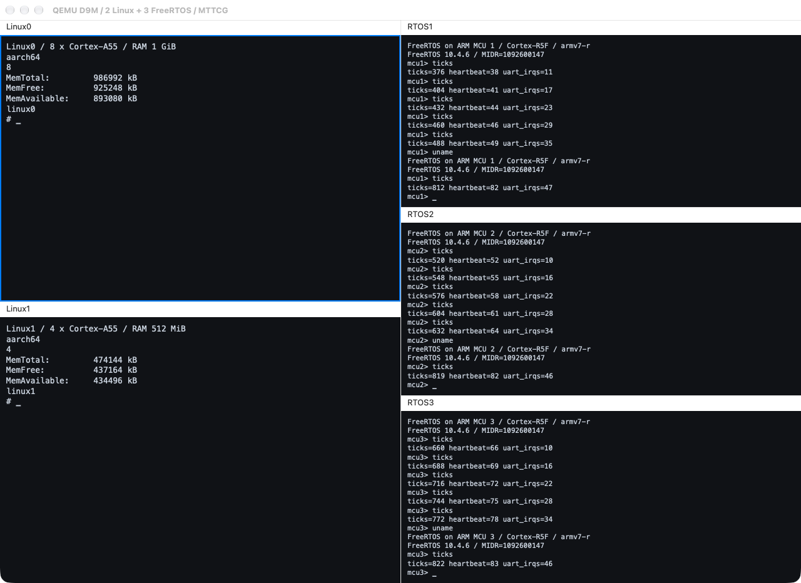

# qemu-d9m：Cocoa 五串口交互

[English](README.md) | 简体中文

QEMU 分支：`d9m/minivirt`，直接基于 `multiarch/virt-domains`。这是六个主项目之外的独立 UI 子项目。

以 `2+3` 五面板同时操作两路 Linux 和三路 FreeRTOS。每个面板独立选择串口、接受键盘输入和滚屏，使用原生等宽字体。

## 实现内容

- 复用多执行域核心，在 Cocoa 中把五路串口组织为 `2+3` 面板；每个面板独立维护串口选择、显示内容、输入焦点和滚屏。
- UART 经 hub 同时连接窗口与测试 socket，使自动验收和窗口交互使用同一条串口数据流。
- View 菜单和键盘输入作用于当前面板；五串口场景分别运行两路 Linux 和三路 FreeRTOS。



| 面板 | CPU | 负载 | RAM |
|---|---|---|---|
| Linux0 | 8 × Cortex-A55 | ARM64 Linux | 1 GiB |
| Linux1 | 4 × Cortex-A55 | ARM64 Linux | 512 MiB |
| RTOS1 | Cortex-R5F | FreeRTOS／MCU 1 | 16 MiB |
| RTOS2 | Cortex-R5F | FreeRTOS／MCU 2 | 16 MiB |
| RTOS3 | Cortex-R5F | FreeRTOS／MCU 3 | 16 MiB |

## 构建与运行

在 macOS 构建 Cocoa；Linux 镜像的准备方法见 [qemu-multiarch](../qemu-multiarch/README.zh-CN.md#构建-linux-负载)。

```sh
python3 tools/lab.py qemu-d9m fetch
projects/qemu-d9m/build.sh
# 需要 clang/lld；可通过 CLANG、LD_LLD 指定工具链。
python3 tools/lab.py qemu-d9m firmware
projects/qemu-d9m/run.sh --layout five --images /path/to/images
```

FreeRTOS 固定为 V10.4.6，生成三份独立标识的 `.work/firmware/freertos-r5f-{1,2,3}.elf`。可用 `--firmware DIRECTORY` 指定已有固件目录。

## 五串口验收

```sh
projects/qemu-d9m/test.sh --suite linux --layout five \
  --images /path/to/images --firmware .work/firmware \
  --display cocoa --hold-seconds 180
```

验收检查五路 shell、两路 Linux 的 CPU 数与内存、私有根文件系统，以及三路 FreeRTOS 的 ticks、heartbeat 和 UART 中断进展；整机复位后再次检查。每路串口同时连接测试 socket 与窗口面板，检查完成后保留窗口供交互。省略 `--display cocoa` 可执行无界面验收。

`test.sh` 默认仍为公共核心 smoke；五串口系统验收需要显式指定 `--suite linux --layout five`。

## 窗口交互

点击面板后，键盘输入进入对应串口；View 菜单作用于当前面板。可在两路 Linux 中执行 `uname -m`、`nproc`、`free`，在三路 FreeRTOS 中执行 `uname`、`ticks`。输入焦点、菜单、滚屏和字体需要另行人工检查。
