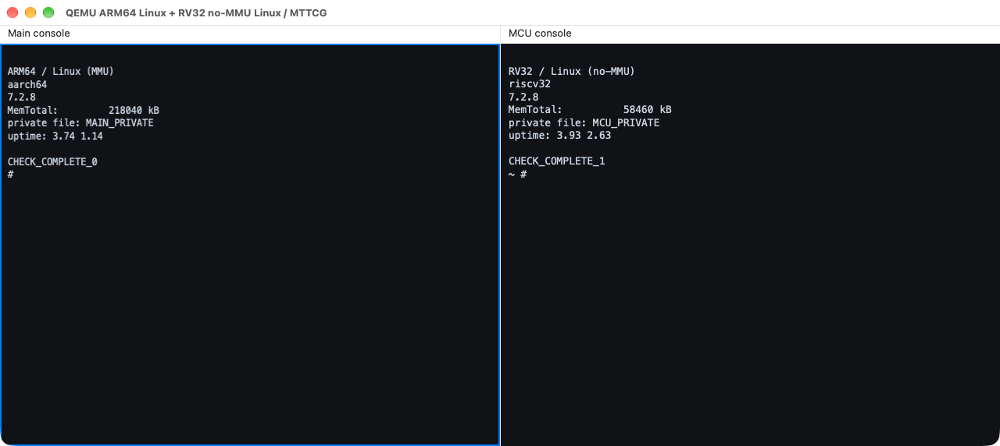

# QEMU execution domains and MTTCG

English | [简体中文](README.zh-CN.md)

QEMU branch: `multiarch/virt-domains`, based on `v11.1.3`.

A single process combines ARM/RISC-V frontends. Each domain has its own CPUs, address space, RAM, controllers, UART, and payload. Explicit shared backends connect memory between domains; `single` provides a serial baseline and `multi` runs each vCPU in a host thread.

## Implementation

- Execution domains isolate CPU, memory, and device state while combining multiple ISA frontends in one QEMU process. Shared memory is configured explicitly.
- MTTCG allows concurrent vCPU execution while retaining per-domain interrupt, reset, and boot state.
- Tests cover private memory, shared atomic operations, and reset, followed by independent Linux shells on mixed-ISA configurations.



The left console runs ARM64 Linux (`aarch64`); the right runs RV32 no-MMU Linux (`riscv32`). The domains have independent UARTs, RAM, and root filesystems and execute concurrently with MTTCG.

The screenshot uses the two-panel Cocoa UI from [qemu-d9m](../qemu-d9m/README.md). The core branch supplies domain execution; the derived UI branch supplies the window.

## Build and smoke test

Run from the repository root:

```sh
python3 tools/lab.py qemu-multiarch fetch
projects/qemu-multiarch/build.sh
projects/qemu-multiarch/test.sh
```

Use `--source PATH`, `--binary PATH`, and `--work PATH` for a development checkout, an existing binary, or a separate output directory. Smoke tests cover configuration guards, a mixed-domain configuration with 15 CPUs, private RAM, shared aliases, reset, shared atomic counters across four ISA pairings, and progress after the peer stops.

## Build Linux payloads

As a non-root Linux user, install Buildroot's host dependencies, then run:

```sh
python3 tools/lab.py qemu-multiarch payloads
```

The tool pins Linux 7.2.8, Buildroot 2026.08.1, and OpenSBI v1.7. It applies the reference files in `configs/` through `olddefconfig` and produces:

- `.work/images/arm64/`: AArch64 MMU Linux and a musl rootfs.
- `.work/images/riscv64/`: RV64 MMU Linux, a musl rootfs, and OpenSBI.
- `.work/images/rv32/`: M-mode no-MMU Linux with an embedded uClibc/FLAT rootfs.

Build one architecture with `python3 tools/payloads.py payloads --work .work --arch arm64`. The first Linux/Buildroot build needs substantial disk space, network access, and time.

Copy the resulting `images/` directory to macOS to use the same run entry points:

```sh
projects/qemu-multiarch/run.sh --main-isa arm64
projects/qemu-multiarch/test.sh --suite linux --main-isa arm64
projects/qemu-multiarch/test.sh --suite linux --main-isa riscv64
# Explicitly select existing images:
projects/qemu-multiarch/test.sh --suite linux --images /path/to/images
```

`run.sh` starts one application domain. `--suite linux` starts a main Linux domain and an RV32 MCU Linux domain and validates two independent shells. See `docs/system/multiarch.rst` in the QEMU source for the full domain and shared-memory CLI.

## Reproduce the mixed-ISA window

Build the Cocoa UI branch, then invoke the Linux acceptance entry point:

```sh
python3 tools/lab.py qemu-d9m fetch
projects/qemu-d9m/build.sh
projects/qemu-multiarch/test.sh --suite linux --main-isa arm64 \
  --binary .work/build/qemu-d9m/qemu-system-multiarch \
  --images /path/to/images --display cocoa --hold-seconds 300
```

| Console | CPU / ISA | Payload | Configured RAM |
|---|---|---|---|
| Main | Cortex-A53 / AArch64 | MMU Linux | 256 MiB |
| MCU | RV32 | M-mode no-MMU Linux | 64 MiB |

The test starts both shells and checks `uname -m`, independent contents of identically named private files, and timed commands. Each UART feeds both a test socket and its Cocoa panel through a hub. The window remains open for the requested time after validation; press Ctrl-C to close it early. Logs and results go to `.work/runs/`.

## Scope

The current ARM/RISC-V profiles are supported. Independent OS domains differ from heterogeneous SMP; arbitrary QEMU ISA combinations, migration, physical cache coherence, and chip performance modeling are outside the current scope.

CoreMark and host sampling are separate benchmarks in `common/qemu-tests/hetero/` and stay outside the core QEMU branch.
