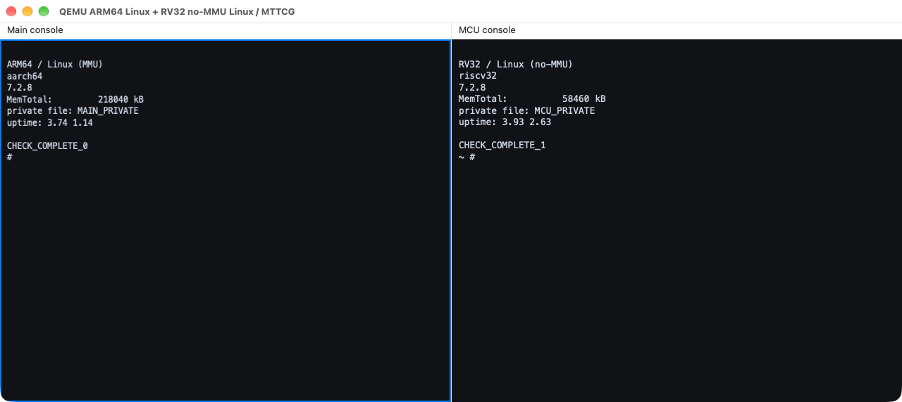

# QEMU 同／异 ISA 多执行域与 MTTCG

[English](README.md) | 简体中文

QEMU 分支：`multiarch/virt-domains`，基线 `v11.1.3`。

一个进程组合 ARM/RISC-V frontend；各 domain 拥有独立 CPU、地址空间、RAM、控制器、串口和负载。通过显式共享 backend 连接内存；single/multi 模式分别提供串行基线与每 vCPU 宿主线程执行。

## 实现内容

- 在一个 QEMU 进程中组合 ARM/RISC-V frontend，以执行域隔离 CPU、地址空间和设备；显式配置的共享 backend 用于域间通信。
- `single` 提供串行执行基线，`multi` 使用 MTTCG 让各 vCPU 在独立宿主线程中执行，保留每个域自己的中断、复位和启动状态。
- 同一套测试覆盖私有内存、共享原子操作与复位，再用独立 Linux shell 验证异 ISA 组合。



左侧为 ARM64 Linux，右侧为 RISC-V RV32 no-MMU Linux，分别显示 `aarch64` 与 `riscv32`。两路有独立串口、RAM 和根文件系统，使用 MTTCG 并行执行。

截图采用 [qemu-d9m](../qemu-d9m/README.zh-CN.md) 的 Cocoa 双面板和原生字体；核心分支提供执行能力，UI 由其派生分支提供。

## 构建和最小验证

在仓库根目录执行：

```sh
python3 tools/lab.py qemu-multiarch fetch
projects/qemu-multiarch/build.sh
projects/qemu-multiarch/test.sh
```

可传 `--source PATH`、`--binary PATH`、`--work PATH` 使用开发 checkout、已有可执行文件和独立输出目录。默认 smoke 覆盖配置保护、15 CPU 混合域、私有 RAM、共享别名、复位、四种 ISA 配对的原子计数及对端停止后的进度。

## 构建 Linux 负载

在非 root Linux 用户下，准备 Buildroot 所需的主机依赖后执行：

```sh
python3 tools/lab.py qemu-multiarch payloads
```

该过程固定 Linux 7.2.8、Buildroot 2026.08.1 和 OpenSBI v1.7 的源码，使用 `configs/` 中的参考配置，经 olddefconfig 生成配置并构建三个输出：

- `.work/images/arm64/`：AArch64 MMU Linux＋musl rootfs。
- `.work/images/riscv64/`：RV64 MMU Linux＋musl rootfs＋OpenSBI。
- `.work/images/rv32/`：M-mode no-MMU Linux＋uClibc/FLAT rootfs，rootfs 嵌入内核。

也可以单独执行 `python3 tools/payloads.py payloads --work .work --arch arm64`。Linux/Buildroot 首次构建需要较多磁盘、网络和时间。

将生成的 `images/` 目录复制到 macOS 后，可用同一运行入口：

```sh
projects/qemu-multiarch/run.sh --main-isa arm64
projects/qemu-multiarch/test.sh --suite linux --main-isa arm64
projects/qemu-multiarch/test.sh --suite linux --main-isa riscv64
# 已有镜像可显式传入：
projects/qemu-multiarch/test.sh --suite linux --images /path/to/images
```

`run.sh` 启动一个应用 domain；`--suite linux` 启动主核 Linux＋RV32 MCU Linux，验证两个独立 shell。配置多个应用域、MCU 域和共享区的完整 CLI 见 QEMU 源码的 `docs/system/multiarch.rst`。

## 复现双路异 ISA 窗口

先构建带 Cocoa UI 的派生分支，再通过同一个 Linux 验收入口运行：

```sh
python3 tools/lab.py qemu-d9m fetch
projects/qemu-d9m/build.sh
projects/qemu-multiarch/test.sh --suite linux --main-isa arm64 \
  --binary .work/build/qemu-d9m/qemu-system-multiarch \
  --images /path/to/images --display cocoa --hold-seconds 300
```

| 串口 | CPU／ISA | 负载 | 配置 RAM |
|---|---|---|---|
| Main console | Cortex-A53／AArch64 | MMU Linux | 256 MiB |
| MCU console | RV32 | M-mode no-MMU Linux | 64 MiB |

验收脚本先启动两个 shell，检查 `uname -m` 的实际输出、同名私有文件的独立内容及定时命令。每路 UART 通过 hub 同时连接到测试 socket 和 Cocoa 面板，窗口显示的就是被检查的串口。完成检查后窗口保留指定秒数；按 Ctrl-C 可提前关闭。日志和结果写入 `.work/runs/`。

## 范围

支持当前实现的 ARM/RISC-V profile，不是任意 QEMU ISA 的自由组合；独立 OS domain 不是异构 SMP。迁移被阻止，物理缓存一致性和芯片性能不在当前模型承诺范围内。

CoreMark 和宿主采样作为独立 benchmark 保留在 `common/qemu-tests/hetero/`，不进入核心 QEMU 分支。
