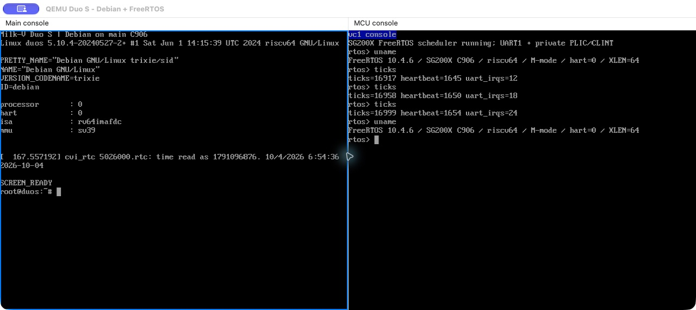

# QEMU SG200X SoCs and Milk-V Duo boards

English | [简体中文](README.zh-CN.md)

QEMU branch: `sg200x/milkv-duos`, based on `multiarch/virt-domains` and QEMU `v11.1.3`, without the Cocoa UI commits.

Board profiles cover Duo/CV1800B, Duo256M/SG2002, and Duo S/SG2000, including C906 main/secondary cores and the ARM64 main-core option on Duo256M/Duo S. Implemented features include private execution domains, boot-critical devices, core reset, direct loading, and non-secure FIP/SD boot.

## Implementation

- Execution domains represent the main and secondary cores. Board profiles select CPUs, RAM, shared windows, and private device views.
- UARTs, timers, interrupts, GPIO/SPI, and secondary-core reset release support independent Linux and FreeRTOS boot and interaction.
- Direct kernel/ELF loading and non-secure FIP/SD boot use the address maps and boot parameters of the selected board.



The example shows Debian and FreeRTOS running on separate Duo S consoles.

## Build and image-free smoke test

```sh
python3 tools/lab.py qemu-sg200x fetch
projects/qemu-sg200x/build.sh
projects/qemu-sg200x/test.sh
```

Smoke tests cover shared windows, aliases, private interrupts, reset release, configuration guards, and timer/GPIO/SPI interrupt and reset behavior across all three board profiles.

## Direct Linux and FreeRTOS boot

Reuse the [qemu-multiarch Linux build](../qemu-multiarch/README.md#build-linux-payloads) for Linux and Buildroot payloads. Duo's 64 MiB RAM requires a smaller kernel; see `common/qemu-tests/multiarch/sg200x/duo-linux.config`. A large generic kernel has not been validated as a Duo image.

FreeRTOS is pinned to V10.4.6. Set an RV64 cross GCC to build SG200X firmware:

```sh
RISCV64_CC=riscv64-linux-gnu-gcc python3 tools/lab.py qemu-sg200x firmware
projects/qemu-sg200x/test.sh --suite linux --images /path/to/images \
  --firmware .work/firmware/sg200x-freertos.elf
```

This project builds C906 firmware. R5F examples are built by `qemu-d9m firmware`. The Linux console address must match the SG200X UART rather than the generic virt PL011 configuration.

## Download a third-party Debian SD image

```sh
# Requires lz4 and mtools; image preparation supports Linux and macOS.
python3 tools/board.py --output .work/images/sg200x/debian
```

The tool downloads the pinned `duos_sd.img.lz4` from [Fishwaldo v1.4.0](https://github.com/Fishwaldo/sophgo-sg200x-debian/releases/tag/v1.4.0), checks SHA256, decompresses a new SD copy, expands it to 1 GiB, and extracts and checks the original FIP from FAT. This is a third-party Debian distribution. See [Milk-V downloads](https://milkv.io/docs/duo/getting-started/download) for vendor images; other images require separate validation.

The original secondary-core FIP section is a placeholder. An independently built FreeRTOS ELF replaces the secondary-core payload without rewriting the original FIP:

```sh
projects/qemu-sg200x/test.sh --suite board \
  --sd .work/images/sg200x/debian/duos_sd-padded.img \
  --fip .work/images/sg200x/debian/vendor-fip.bin \
  --firmware .work/firmware/sg200x-freertos.elf
```

Automated tests use an SD snapshot, validate both shells, reset the machine, and validate again. For interactive use, replace `test.sh --suite board` with `run.sh` and retain the three file arguments. Connect to the second UART with `nc 127.0.0.1 54321`.

After interrupting U-Boot, use these commands for this pinned image:

```text
mmc dev 0
fatload mmc 0:1 0x80200000 /vmlinuz-5.10.4-20240527-2+
fatload mmc 0:1 0x81200000 /fdt/linux-image-duos-5.10.4-20240527-2+/cv181x_milkv_duos_sd.dtb
fdt addr 0x81200000
fdt set /cpus/cpu@0 riscv,isa rv64imafdc
setenv bootargs console=ttyS0,115200 earlycon=sbi root=/dev/mmcblk0p2 rootwait rw
booti 0x80200000 - 0x81200000
```

The test image's guest login is `root` / `rv`; these are public guest credentials. Acceptance includes the DTB ISA adjustment shown above, performed in RAM.

## Scope

FIP mode skips ROM/FSBL and PLL/DDR initialization. Full vendor BootROM behavior, secure boot, and RVV 0.7 are outside the current scope. Booting an OS does not establish complete Ethernet, USB, DMA, or multimedia support. Build configuration, images, FIP, and secondary-core ELF must match; main-core boot and secondary-core execution are checked separately.
