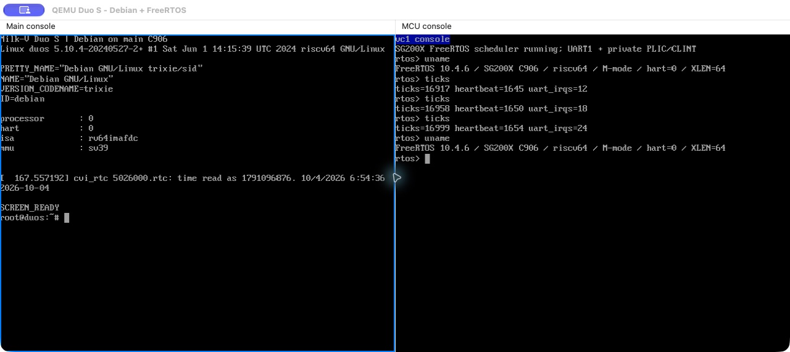

# QEMU SG200X SoC 与 Milk-V Duo 系列板卡

[English](README.md) | 简体中文

QEMU 分支：`sg200x/milkv-duos`，基于 `multiarch/virt-domains` 和 QEMU `v11.1.3`，不包含 Cocoa UI 提交。

支持 Duo/CV1800B、Duo256M/SG2002、Duo S/SG2000 的板级组合，C906 大小核，以及 Duo256M/Duo S 的 ARM64 主核选择。主要功能为私有执行域、启动关键外设、大小核复位、直接启动和非安全 FIP/SD 启动。

## 实现内容

- 以多执行域承载大核／小核，按 Duo、Duo256M、Duo S 组合 CPU、RAM、共享窗口和私有外设视图。
- 建模启动所需的串口、计时器、中断、GPIO/SPI 及小核复位释放，使 Linux 与 FreeRTOS 可以分别启动和交互。
- 提供内核／ELF 直接加载和非安全 FIP／SD 启动两条路径；板级配置决定地址映射与启动参数。



示例展示 Duo S 的 Debian 与 FreeRTOS 双串口运行。

## 构建与无镜像 smoke

```sh
python3 tools/lab.py qemu-sg200x fetch
projects/qemu-sg200x/build.sh
projects/qemu-sg200x/test.sh
```

smoke 覆盖三个板型的共享窗口、别名、私有中断、复位释放、配置保护，以及 timer/GPIO/SPI 的中断和复位行为。

## 通用 Linux＋FreeRTOS 直接启动

Linux 内核和 Buildroot 负载复用 [qemu-multiarch](../qemu-multiarch/README.zh-CN.md) 的 Linux 构建过程。Duo 的 64 MiB RAM 需要额外裁剪的内核，参考 `common/qemu-tests/multiarch/sg200x/duo-linux.config`；不能直接把大型通用内核当作已验收的 Duo 镜像。

FreeRTOS 内核固定 V10.4.6。设置 RV64 交叉 GCC 后，可同时生成 SG200X 固件：

```sh
RISCV64_CC=riscv64-linux-gnu-gcc python3 tools/lab.py qemu-sg200x firmware
projects/qemu-sg200x/test.sh --suite linux --images /path/to/images \
  --firmware .work/firmware/sg200x-freertos.elf
```

该项目只构建 C906 固件；R5F 示例由 `qemu-d9m firmware` 构建。Linux 驱动中的 console 地址应匹配 SG200X 的 UART；与通用 virt 的 PL011 参数不同。

## 下载第三方 Debian SD 系统

```sh
# 安装 lz4、mtools；Linux/macOS 都可以准备镜像。
python3 tools/board.py --output .work/images/sg200x/debian
```

工具从 [Fishwaldo v1.4.0](https://github.com/Fishwaldo/sophgo-sg200x-debian/releases/tag/v1.4.0) 下载固定的 `duos_sd.img.lz4`，校验 SHA256，解压为新 SD 副本并扩到 1 GiB，再从 FAT 分区提取并校验原始 FIP。这是第三方 Debian 发行镜像，不是 Milk-V 官方原版系统。官方镜像入口另见 [Milk-V 下载页](https://milkv.io/docs/duo/getting-started/download)，其他镜像需要单独验证。

原始 FIP 的小核段只是占位程序；使用独立编译的 FreeRTOS ELF 覆盖小核负载，无需重写原始 FIP：

```sh
projects/qemu-sg200x/test.sh --suite board \
  --sd .work/images/sg200x/debian/duos_sd-padded.img \
  --fip .work/images/sg200x/debian/vendor-fip.bin \
  --firmware .work/firmware/sg200x-freertos.elf
```

自动测试使用 SD snapshot，经过两路 shell 检查后整机复位并再次检查。交互运行将 `test.sh --suite board` 换为 `run.sh`，保留三项文件参数；第二串口连接 `nc 127.0.0.1 54321`。

手工中断 U-Boot 后，按该固定镜像执行：

```text
mmc dev 0
fatload mmc 0:1 0x80200000 /vmlinuz-5.10.4-20240527-2+
fatload mmc 0:1 0x81200000 /fdt/linux-image-duos-5.10.4-20240527-2+/cv181x_milkv_duos_sd.dtb
fdt addr 0x81200000
fdt set /cpus/cpu@0 riscv,isa rv64imafdc
setenv bootargs console=ttyS0,115200 earlycon=sbi root=/dev/mmcblk0p2 rootwait rw
booti 0x80200000 - 0x81200000
```

Debian 测试镜像登录为 `root` / `rv`；这是公开测试镜像的客体账户，不是宿主或构建机凭据。自动验收包含上面的 RAM 内 DTB ISA 调整。

## 范围

FIP 模式跳过 ROM/FSBL、PLL/DDR 初始化；不声称完整厂商 BootROM、安全启动或 RVV 0.7 支持。网口、USB、DMA 和多媒体不能由“系统可启动”推导为完整实现。编译配置、镜像、FIP 和小核 ELF 必须匹配；大核启动通过也不等于小核运行通过。
