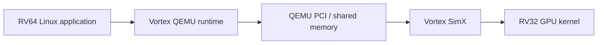
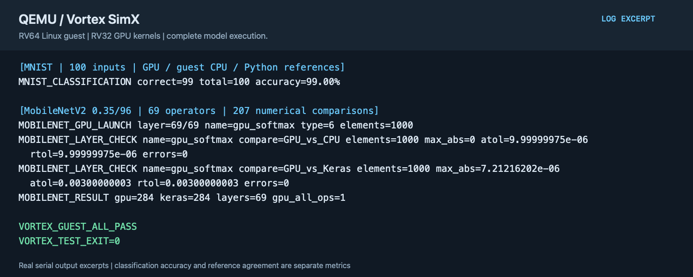

# QEMU Vortex GPGPU instruction-level simulation

English | [简体中文](README.zh-CN.md)

The QEMU PCI device forwards Linux guest runtime requests to SimX. GPU kernels use Vortex RV32 instructions, while Linux clients use the RV64 ABI.

## Implementation

- The RV64 guest runtime submits GPU programs, arguments, and memory operations through QEMU PCI. Host SimX executes the Vortex RV32/SIMT instruction stream.
- Vortex LLVM compiles GPU kernels. Linux clients and GPU kernels are built separately and exchange data and completion status through the transport interface.
- SimX includes cache writeback/invalidation fixes and a separate functional configuration. Model outputs are compared independently with guest CPU and Python/Keras references.



QEMU and Vortex use `vortex-gpgpu-isa`; see [project.json](project.json) for revisions. `SIMX_FUNCTIONAL` is a distinct functional configuration; its cycle counts are not timing-model results.

## Build

Use the Vortex toolchain release matching upstream `VERSION`, v3.0.1. Set `VORTEX_TOOLS` to a directory containing `llvm-vortex/`, `libc32/`, and `libcrt32/`. See the [shared guide](../../common/accelerators/README.md) for host and guest dependencies.

Fetch source first, then use the generated upstream installer:

```sh
projects/qemu-vortex-isa/fetch.sh
export VORTEX_TOOLS="$LAB_WORK/tools/vortex-v3.0.1"
SRC="$LAB_WORK/sources/qemu-vortex-isa/vortex"
BLD="$LAB_WORK/build/qemu-vortex-isa/vortex"
mkdir -p "$BLD"
(cd "$BLD" && "$SRC/configure" --xlen=32 --tooldir="$VORTEX_TOOLS" --osversion=ubuntu/focal && \
  ./ci/toolchain_install.sh --llvm --libc32 --libcrt32 --verilator)
```

For the RTL path, set `VERILATOR` to the installed `bin/verilator` and `VERILATOR_ROOT` to the directory containing `include/verilated.h`. Check these with `verilator -V`.

```sh
projects/qemu-vortex-isa/build.sh --component qemu
projects/qemu-vortex-isa/build.sh --component backend
projects/qemu-vortex-isa/build.sh --component guest --suite full
```

## Model validation

Export model data using independent Python/Keras references, with caches on the work disk:

```sh
export KERAS_HOME="$LAB_WORK/cache/keras"
python3 common/accelerators/export_mnist.py \
  --out "$LAB_WORK/build/qemu-vortex-isa/payload/vortex/mnist"
python3 common/accelerators/export_mobilenet.py --image /path/to/cat.jpg \
  --out "$LAB_WORK/build/qemu-vortex-isa/payload/vortex/mobilenet"
projects/qemu-vortex-isa/prepare.sh --suite full --images /path/to/images
projects/qemu-vortex-isa/test.sh --suite full --samples 2 --timeout 3600
```

Basic checks cover PCI windows, timeout recovery, demo/2D kernels, and SGEMM. MNIST compares GPU, guest CPU, and Python classifications and intermediate tensors. Pass `--samples 100` to both `prepare` and `test` for the complete image set.

MobileNetV2 uses the 0.35/96 configuration and checks all 69 operators through 207 numerical comparisons. Its performance cannot be compared directly with Coral's 1.0/224 model. This path has no Gemma acceptance suite.

## Example output



The figure shows 100 MNIST inputs and the complete 69-operator MobileNet graph. Classification accuracy and agreement with numerical references are separate checks. It is typeset from actual acceptance output, rather than a desktop capture; see the [text excerpt](images/test-output.txt).
