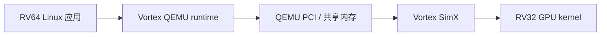
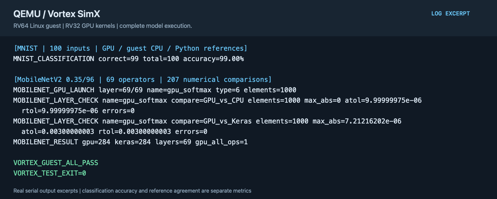

# QEMU Vortex GPGPU 指令级模拟

[English](README.md) | 简体中文

QEMU PCI 设备将 Linux guest 的 Vortex runtime 请求交给 SimX。GPU 内核使用 Vortex 专用 RV32 ISA，Linux 客户端使用 RV64 ABI。

## 实现内容

- RV64 Linux 中的 Vortex runtime 通过 QEMU PCI 设备提交 GPU 程序、参数和内存操作，宿主 SimX 执行 Vortex RV32/SIMT 指令流。
- GPU 代码由 Vortex 专用 LLVM 编译；Linux 客户端与 GPU 内核分别构建，并通过传输接口交换数据和完成状态。
- SimX 保留缓存写回／失效修正和独立功能执行配置；模型输出与 guest CPU、Python/Keras 参考分别比较。



QEMU 与 Vortex 分支均为 `vortex-gpgpu-isa`，固定版本见 [project.json](project.json)。SimX 包含缓存写回/失效修正；`SIMX_FUNCTIONAL` 是单独的功能执行配置，不能用其周期数作为时序结论。

## 构建

先按 Vortex 上游 `VERSION` 的 v3.0.1 安装专用预编译工具链，再设置 `VORTEX_TOOLS` 指向包含 `llvm-vortex/`、`libc32/`、`libcrt32/` 的目录。源码和 guest 环境参见[共用说明](../../common/accelerators/README.zh-CN.md)。

先获取源码，再使用生成的上游安装脚本：

```sh
projects/qemu-vortex-isa/fetch.sh
export VORTEX_TOOLS="$LAB_WORK/tools/vortex-v3.0.1"
SRC="$LAB_WORK/sources/qemu-vortex-isa/vortex"
BLD="$LAB_WORK/build/qemu-vortex-isa/vortex"
mkdir -p "$BLD"
(cd "$BLD" && "$SRC/configure" --xlen=32 --tooldir="$VORTEX_TOOLS" --osversion=ubuntu/focal && \
  ./ci/toolchain_install.sh --llvm --libc32 --libcrt32 --verilator)
```

RTL 路线再设置 `VERILATOR` 为安装后的 `bin/verilator`，`VERILATOR_ROOT` 为包含 `include/verilated.h` 的目录，可通过 `verilator -V` 核对。


```sh
projects/qemu-vortex-isa/build.sh --component qemu
projects/qemu-vortex-isa/build.sh --component backend
projects/qemu-vortex-isa/build.sh --component guest --suite full
```

## 模型验证

模型数据由独立 Python/Keras 参考生成，导出时将缓存也设在工作磁盘：

```sh
export KERAS_HOME="$LAB_WORK/cache/keras"
python3 common/accelerators/export_mnist.py \
  --out "$LAB_WORK/build/qemu-vortex-isa/payload/vortex/mnist"
python3 common/accelerators/export_mobilenet.py --image /path/to/cat.jpg \
  --out "$LAB_WORK/build/qemu-vortex-isa/payload/vortex/mobilenet"
projects/qemu-vortex-isa/prepare.sh --suite full --images /path/to/images
projects/qemu-vortex-isa/test.sh --suite full --samples 2 --timeout 3600
```

基础验收包括 PCI 窗口、预算超时后恢复、demo/二维任务、SGEMM。MNIST 比对 GPU/客体 CPU/Python 分类及中间张量；`--samples 100` 执行完整图像集合。MobileNetV2 使用 0.35/96 配置，验证全部 69 个算子和 207 组逐层数值比较，不能与 Coral 的 1.0/224 模型直接比较性能。此路线没有 Gemma 验收。

## 运行示例



图中展示 100 张 MNIST 和 MobileNetV2 0.35/96 全部 69 个算子的运行结果；分类正确率与数值参考一致性是不同指标。 图片由实际验收日志的选段排版生成，并非桌面截图；可查看[文本摘录](images/test-output.txt)。
