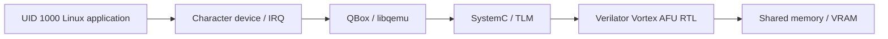
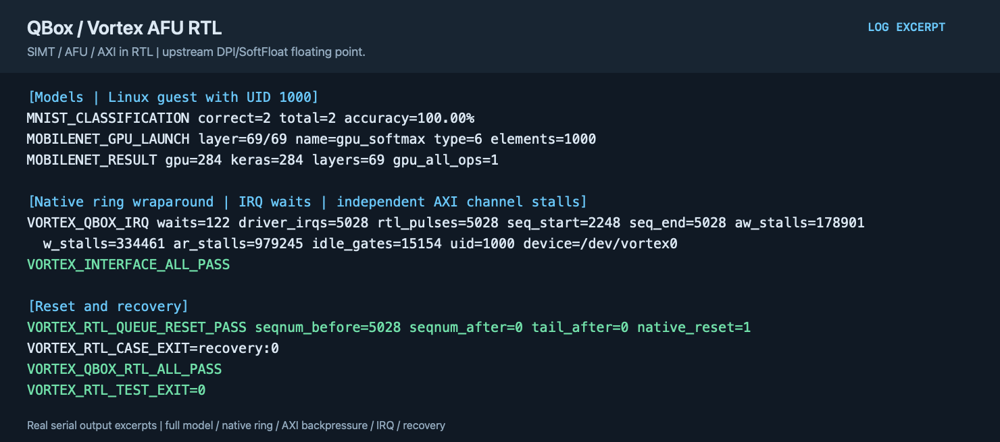

# QEMU / QBox Vortex GPGPU RTL co-simulation

English | [简体中文](README.zh-CN.md)

QBox connects CPU execution, TLM shared memory, a Linux driver, and Vortex AFU RTL. Control, GPU execution, and external-memory transactions pass through the actual AFU interface.

## Implementation

- An RV64 Linux application submits native ring commands through a character-device driver. QBox connects control and shared-memory transactions to Vortex AFU RTL.
- The AFU/AXI bridge converts memory requests to TLM transactions. Completion signals reach the application through the PLIC and Linux IRQ driver, supporting blocking waits.
- Acceptance covers GPU numerics, unprivileged access boundaries, ring wraparound, AXI backpressure, and reset/recovery. The default floating-point model uses upstream DPI/SoftFloat.



The upstream simulation configuration executes SIMT control, pipelines, and AFU/AXI in RTL, with floating-point numerics supplied by DPI/SoftFloat. This is not structural RTL validation of the entire FPU.

QBox and Vortex use `vortex-gpgpu-rtl`, maintained independently from the ISA path on the same respective upstream bases. See [project.json](project.json). Acceptance exercises the AFU integration, including the host-facing control and memory paths.

## Build and validate

```sh
projects/qemu-vortex-rtl/fetch.sh
projects/qemu-vortex-rtl/build.sh --component rtl
projects/qemu-vortex-rtl/build.sh --component qbox
projects/qemu-vortex-rtl/build.sh --component guest --suite full
projects/qemu-vortex-rtl/build.sh --component driver
```

In addition to the [shared environment and kernel parameters](../../common/accelerators/README.md), set `VORTEX_TOOLS` and `VERILATOR_ROOT`; use `VERILATOR` to override the executable. Install the GPU toolchain as described for the [ISA path](../qemu-vortex-isa/README.md). Build SoftFloat for the current host architecture.

Use the ISA guide's MNIST/MobileNet export commands with this project's `payload/vortex/` output directory, then run:

```sh
projects/qemu-vortex-rtl/prepare.sh --suite full --images /path/to/images
projects/qemu-vortex-rtl/test.sh --suite smoke --timeout 600
projects/qemu-vortex-rtl/test.sh --suite full --samples 2 --timeout 21600
```

`smoke` checks TLM/AFU control independently. `--suite linux` covers demo, SGEMM, reset/recovery, real IRQs, and unprivileged access. `mnist` and `mobilenet` add their models; `interface` adds native ring wraparound; `full` combines them. `--backpressure` requires observed stalls on independent AXI channels.

MobileNet acceptance requires all 69 GPU operator launches, 207 numerical comparisons, and reference classification agreement. Full RTL models take longer; smaller real workloads are a useful starting point, but partial execution does not count as full-model acceptance.

## Example output



The figure shows complete MobileNet execution, unprivileged IRQ waits, native ring wraparound, and reset/recovery. Floating point uses DPI/SoftFloat. It is typeset from actual acceptance output, rather than a desktop capture; see the [text excerpt](images/test-output.txt).
