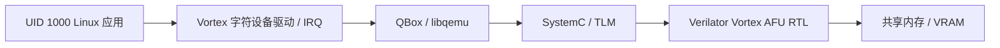
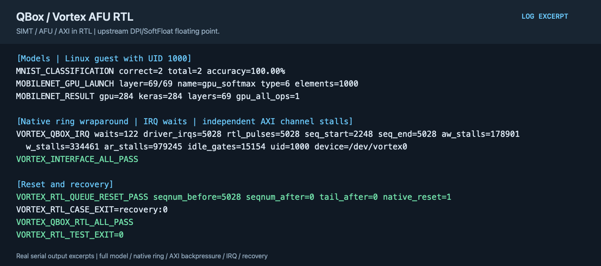

# QEMU／QBox Vortex GPGPU RTL 联合仿真

[English](README.md) | 简体中文

QBox 将 CPU、TLM 共享内存、Linux 驱动和 Vortex AFU RTL 连接起来。控制面、GPU 执行和外部内存事务均经过实际 AFU 接口。

## 实现内容

- RV64 Linux 应用经字符设备驱动提交原生环形队列；QBox 将控制事务和共享内存访问连接到 Vortex AFU RTL。
- AFU／AXI 桥把访存请求转换为 TLM 事务，RTL 完成信号触发 PLIC／Linux IRQ，应用通过阻塞等待获取结果。
- 验收同时覆盖 GPU 数值、非特权访问边界、队列回绕、AXI 背压与复位恢复。默认浮点数值由上游 DPI/SoftFloat 提供。



默认使用上游仿真配置：SIMT 控制、流水线、AFU/AXI 在 RTL 中执行，浮点数值使用上游 DPI/SoftFloat 模型。本路线不把该结果作为完整浮点运算单元结构的 RTL 验证。

QBox 和 Vortex 分支均为 `vortex-gpgpu-rtl`；与 ISA 路线从相同上游基线分别维护，版本见 [project.json](project.json)。不以绕开 AFU 的处理器 RTL 测试代替整条链路验收。

## 构建与验证

```sh
projects/qemu-vortex-rtl/fetch.sh
projects/qemu-vortex-rtl/build.sh --component rtl
projects/qemu-vortex-rtl/build.sh --component qbox
projects/qemu-vortex-rtl/build.sh --component guest --suite full
projects/qemu-vortex-rtl/build.sh --component driver
```

除[共用环境与内核驱动参数](../../common/accelerators/README.zh-CN.md)外，需要设置 `VORTEX_TOOLS`、`VERILATOR_ROOT`，可用 `VERILATOR` 指定可执行文件。GPU 工具链安装方法同 [ISA 路线](../qemu-vortex-isa/README.zh-CN.md)。SoftFloat 必须按当前宿主架构构建，禁止混用另一宿主的静态库。

按 ISA 路线的模型导出命令生成 MNIST/MobileNet 数据，将输出目录改为本项目的 `payload/vortex/`，然后：

```sh
projects/qemu-vortex-rtl/prepare.sh --suite full --images /path/to/images
projects/qemu-vortex-rtl/test.sh --suite smoke --timeout 600
projects/qemu-vortex-rtl/test.sh --suite full --samples 2 --timeout 21600
```

独立的 `smoke` 检查 TLM/AFU 控制接口；Linux 验收使用 `--suite linux`，包括 demo、SGEMM、复位恢复、实际 IRQ 和非特权访问。`mnist`、`mobilenet`、`interface`、`full` 分别追加模型、原生环形队列回绕或全部检查。`--backpressure` 验证独立 AXI 通道的停顿计数。

MobileNet 必须完成 69 次 GPU 算子启动、207 组数值比较并匹配参考分类。RTL 全模型耗时长，可先执行实际小负载；只完成 smoke 或部分模型不能判为完整模型通过。

## 运行示例



图中展示完整 MobileNet、非特权 IRQ 等待、队列回绕与复位恢复结果；浮点采用 DPI/SoftFloat。 图片由实际验收日志的选段排版生成，并非桌面截图；可查看[文本摘录](images/test-output.txt)。
